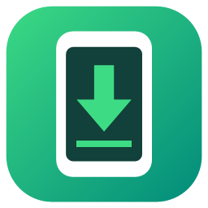
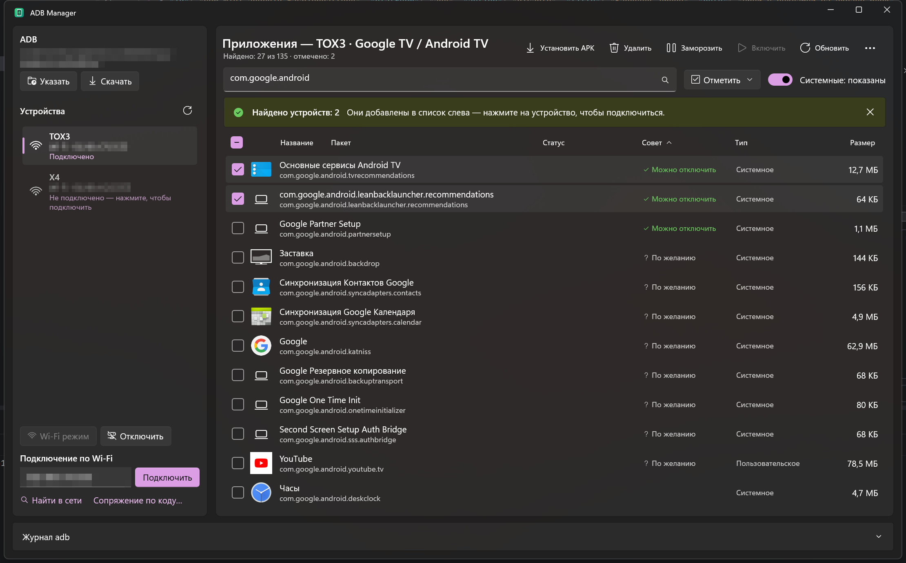

  

<h1 align="center">ADB Manager</h1>

  <b>Debloat Android TV, Google TV and Android phones from Windows — remove ads and bloatware without root.</b> 
  Uninstall, disable (freeze) and install apps over ADB, block ads and telemetry, undo any change.

  <a href="https://github.com/beliy26/AdbManager/releases/latest"><b>⬇ Download for Windows (x64 / ARM64)</b></a> ·
  <a href="https://beliy26.github.io/AdbManager/">Website</a> ·
  <a href="README.md">Русский</a> ·
  <a href="LICENSE">MIT</a>

ADB Manager is a free, open-source ADB GUI for Windows 10/11 (WinUI 3). It connects to a smart TV, TV box or phone
over USB or Wi-Fi, lists every app with its real name and icon, and tells you what is safe to disable: ad services and
telemetry of Google TV, TCL, Xiaomi (PatchWall), Sony, Philips, Hisense, Haier, Fire TV, Yandex TV, Salute TV, plus phone
bloatware from Samsung, Xiaomi and OPPO. Critical system packages are protected, the device state is backed up before the
first change, and everything can be rolled back. No installation and no command line — unzip and run `AdbManager.exe`.
The interface is available in English and Russian.

## Getting started

1. Download the archive from the [latest release](https://github.com/beliy26/AdbManager/releases/latest)
   (`win-x64` for a regular PC, `win-arm64` for Snapdragon) and unzip it.
2. On the device, enable Developer options (tap the build number 7 times) and USB debugging or network debugging.
3. Run `AdbManager.exe`, connect over USB, by `IP:5555` or with “Find on network”, and accept “Allow debugging?” on the device.
4. “Mark → Recommended to disable” → “Freeze”. If something goes wrong — “… → Undo changes”.

## Features

**Connection**
- USB devices appear automatically; Wi-Fi via `adb connect IP:port`; pairing by code for Android 11+ wireless debugging.
- “Wi-Fi mode” switches a USB-connected phone to `adb tcpip 5555` and connects to it over the network.
- **Find on network** scans the home network for open adb port 5555 and devices announced over mDNS; warns when a VPN on the PC blocks the connection.
- Device type (phone, tablet, TV) is detected automatically; one device is connected at a time.
- Warns when the device accepts network debugging without confirmation (`ro.adb.secure=0`).

**Apps**
- Table of installed apps with **name and icon**, package, state, advice, type and size; sorting and search.
- **Install APK** — file picker or drag and drop, `-d`, `-g`, split APKs. Checks free space first and clears the app cache (`pm trim-caches`) if needed; errors are shown as one readable line.
- **Uninstall** (system apps — for the current user only, restorable), **freeze** (`pm disable-user`), enable apps stopped by Android as unused.
- Check boxes and bulk actions; **selection presets** with export and import; save APKs to the PC; copy the app list as a prompt for an LLM.

**Ad and telemetry removal**
- **Advice column** — “Can be disabled”, “Optional”, “Keep”, “Protected”. Sources: the [ChistyTV](https://github.com/by-sonic/chistytv) database, [CleanYourTV](https://github.com/Gathin23/cleanyourtv) lists for 200+ TV models (1,100+ packages), and our own list of phone bloatware.
- **Protection**: critical system packages, the only home screen and TV inputs (HDMI/AV/tuner) can't be frozen or removed. **Expert mode** lifts the protection after a warning.
- **Privacy audit** — the system voice assistant, apps that used the microphone, known ACR and telemetry.
- **Private DNS** — AdGuard, AdGuard Family or a custom server; if DNS-over-TLS is blocked by the provider, the previous DNS is restored automatically.

**Backup and undo**
- Packages, `getprop` and system settings are saved before the first change; every action goes to a journal.
- “Undo changes” reverts freezing, removal of system apps, DNS and home screen changes. On TVs the list of frozen packages is mirrored to the device in ChistyTV's format, so it can be undone from another PC too.
- “Check after a firmware update” finds what the update brought back.

**For TVs**
- **TV launcher** — install [Projectivy Launcher](https://github.com/spocky/miproja1) or [LTvLauncher](https://github.com/leanbitlab-org/LtvLauncher) from GitHub and make it the home screen.
- Device screenshot to PNG.

**adb**
- Finds `adb.exe` in `PATH`, `ANDROID_HOME`, the Android SDK; otherwise downloads the official platform-tools from Google (with SHA-256-verified mirrors as a fallback).

## Requirements

- Windows 10 1809 or later, x64 or ARM64.
- Developer options and USB debugging (or network / wireless debugging) enabled on the device.
- To build from source — [.NET SDK 10](https://dotnet.microsoft.com/download): `git clone https://github.com/beliy26/AdbManager.git`, `cd AdbManager`, `dotnet run --project src/AdbManager` (or open `AdbManager.sln` in an IDE). Sources are in `src/AdbManager`, the website and screenshots in `docs`, helper scripts in `tools`.

## How it works

App names and icons live inside the APK, and downloading whole APKs is slow. ADB Manager reads only the ZIP central
directory, `AndroidManifest.xml`, `resources.arsc` and the icon file straight from the device (`stat`, `tail`, `dd`),
parses the binary XML and resource table, and supports raster, adaptive and vector icons and split APKs — usually 3–6 adb
calls per app. Results are cached in `%LOCALAPPDATA%\AdbManager\icons`. More details — in the [Russian README](README.md#как-это-работает).

## Credits and license

[MIT](LICENSE). Package databases from [ChistyTV](https://github.com/by-sonic/chistytv) and
[CleanYourTV](https://github.com/Gathin23/cleanyourtv) (both MIT); see [THIRD-PARTY-NOTICES.md](THIRD-PARTY-NOTICES.md).
Launchers are not bundled — they are downloaded from their authors' GitHub releases on request.
