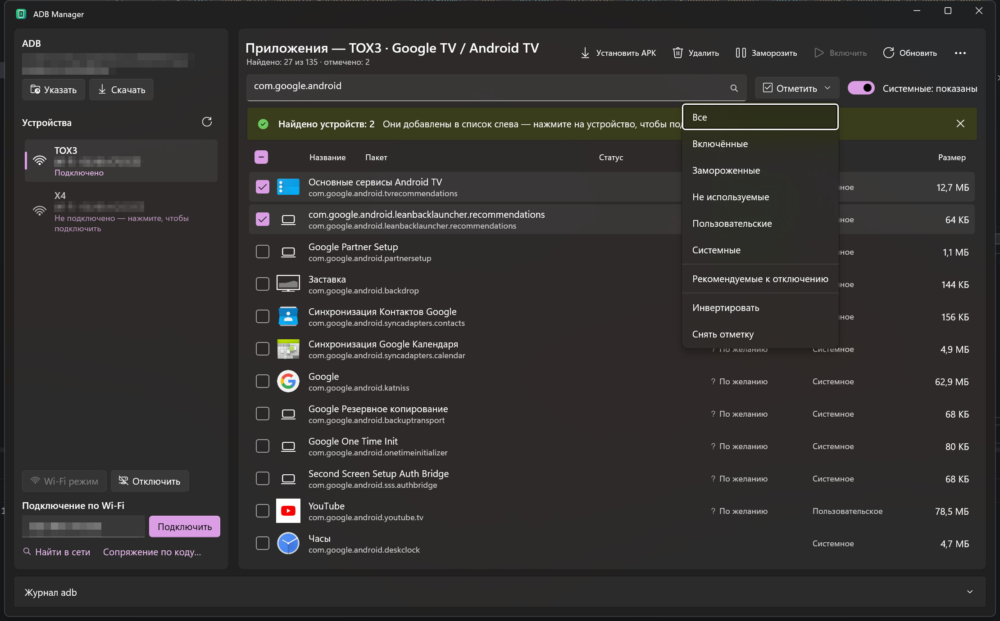
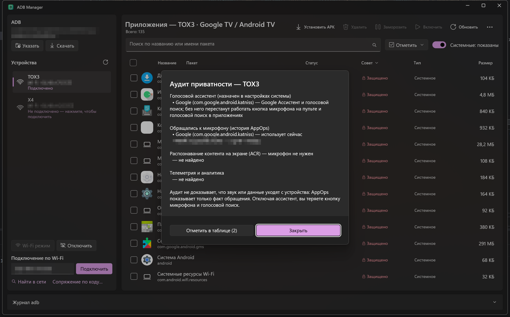
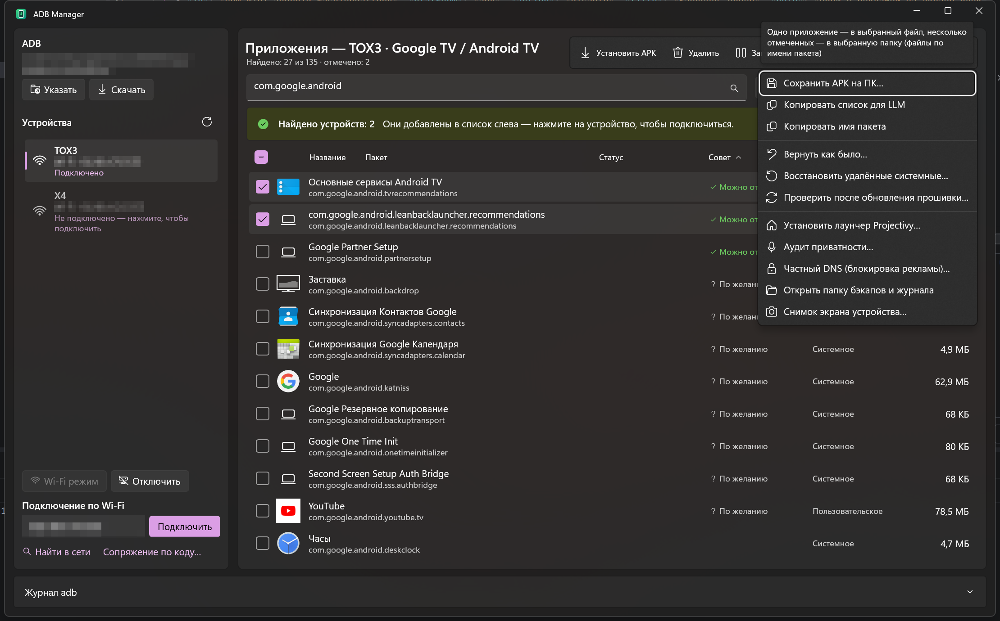
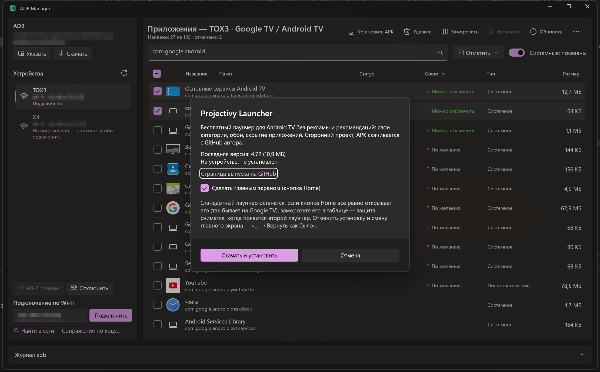

<p align="center">
  
</p>

<h1 align="center">ADB Manager</h1>

<p align="center">
  Приложение для Windows на WinUI 3: управление Android-смартфоном, телевизором или приставкой по ADB —<br>
  установка, удаление и заморозка приложений, очистка от рекламы и телеметрии с откатом изменений.
</p>


## Возможности

**Подключение**
- По USB — устройства появляются в списке автоматически (опрос каждые 3 секунды).
- По Wi-Fi — `adb connect` по адресу `IP:порт`.
- Сопряжение по коду для Android 11+ (Беспроводная отладка → «Подключить устройство с помощью кода»).
- Кнопка «Wi-Fi режим» переводит подключённый по USB телефон в `adb tcpip 5555`, сама определяет его IP и подключается — после этого кабель можно отключить.
- **Найти в сети** — сканирует домашнюю сеть на открытый порт adb 5555 и находит устройства, которые adb видит по mDNS (в т.ч. беспроводная отладка Android 11+). Найденные добавляются в список устройств — подключение кликом. Если подключиться не удаётся из-за VPN на компьютере — подскажет.
- В списке устройств — подключённые по USB, найденные в сети и сопряжённые по коду (запоминаются; адрес беспроводной отладки обновляется по mDNS). **Одновременно подключено одно устройство**: при выборе другого прежнее сетевое подключение разрывается, а список приложений очищается и загружается заново. USB-подключение adb разорвать не может — такое устройство просто остаётся в списке.
- Предупреждение, если устройство пускает по сети без подтверждения (`ro.adb.secure=0`).

**Приложения**
- Таблица установленных приложений с **названием и иконкой**, именем пакета, статусом, советом, типом и размером.
- Сортировка по любой колонке (клик по заголовку, повторный клик — обратный порядок); выбор запоминается.
- Поиск по названию и имени пакета, переключатель «показывать системные».
- **Установка APK** — через диалог выбора файлов или перетаскиванием в окно; опции `-d` (откат версии), `-g` (выдать разрешения), `install-multiple` для split APK.
- **Удаление** одного или нескольких приложений, с опцией сохранения данных. Системные приложения удаляются только для текущего пользователя (`pm uninstall --user 0`) и восстанавливаются командой `adb shell cmd package install-existing <пакет>`.
- **Заморозка** (`pm disable-user`): приложение не запускается и не получает уведомлений, данные сохраняются.
- Статус **«Не используется»** — приложения, которые Android сам остановил из-за долгого неиспользования. Кнопка «Включить» работает и для них (см. ниже).
- **Чекбоксы и массовые действия**: «Отметить» все, включённые, замороженные, не используемые, пользовательские, системные, рекомендуемые к отключению — и заморозить / включить / удалить / сохранить APK разом.
- Сохранение APK на компьютер — одного приложения или сразу всех отмеченных (в выбранную папку), копирование имени пакета.
- **Копировать список для LLM** — таблица приложений с готовым запросом к ИИ: что можно удалить или заморозить.



**Очистка от рекламы и телеметрии**
- **Колонка «Совет»** — «Можно отключить» (реклама, телеметрия, демо), «По желанию», «Не трогать», «Защищено». Источники:
  - база [ЧистогоТВ](https://github.com/by-sonic/chistytv); платформа (Яндекс ТВ, Салют ТВ, Xiaomi, TCL, Haier, Hisense, Google TV) определяется автоматически;
  - списки отключения [CleanYourTV](https://github.com/Gathin23/cleanyourtv) для 200+ моделей ТВ (TCL, Xiaomi, Sony, Philips, Hisense, Fire TV…) — 1 100+ пакетов с пояснениями;
  - свой список рекламных и шпионских предустановок телефонов: скрытые установщики Facebook и AppCloud, Samsung Free / Global Goals / Visit In, системная реклама и телеметрия Xiaomi и OPPO, «очистители».
- «Отметить → Рекомендуемые к отключению» отмечает всё с советом «Можно отключить».
- **Защита**: критичные системные пакеты (системный интерфейс, настройки, телефония, Wi-Fi, Bluetooth, клавиатура, установщик, Google Play, WebView…) программа не даст заморозить или удалить. Также защищены текущий **главный экран**, если другого лаунчера нет, и **входы ТВ** — пакеты, обслуживающие HDMI/AV/тюнер: если их отключить, вход показывает «Нет сигнала».
- **Аудит приватности** — голосовой ассистент, назначенный в системе, приложения, обращавшиеся к микрофону (история AppOps), известные ACR и телеметрия; найденное можно отметить в таблице.
- **Частный DNS**: AdGuard (блокировка рекламы и трекеров), AdGuard Семейный, свой сервер или выключить (Android 9+).



**Бэкап и откат**
- Перед первым изменением сохраняются список пакетов, `getprop` и системные настройки; все действия пишутся в журнал.
- «Вернуть как было» отменяет заморозку, удаление системных приложений, смену DNS и главного экрана, удаляет установленный программой лаунчер.
- «Восстановить удалённые системные» возвращает любые системные приложения, удалённые для пользователя.
- **Проверить после обновления прошивки** — обновление возвращает замороженное и удалённое; программа сравнит журнал с устройством и предложит повторить.



**Для телевизоров**
- **Лаунчер Projectivy** — «… → Установить лаунчер Projectivy»: последняя версия [Projectivy Launcher](https://github.com/spocky/miproja1/releases) (главный экран для Android TV без рекламы) скачивается с GitHub, устанавливается и по желанию становится главным экраном (`cmd package set-home-activity`). Установку и смену главного экрана можно отменить через «Вернуть как было».
- **Снимок экрана устройства** в PNG.



**Прочее**
- Журнал всех выполненных команд adb.

**adb**
- Ищет `adb.exe` в `PATH`, `ANDROID_HOME`/`ANDROID_SDK_ROOT`, `%LOCALAPPDATA%\Android\Sdk`.
- Если не нашёл — кнопка «Скачать» загружает официальные [platform-tools](https://developer.android.com/tools/releases/platform-tools) от Google.

## Требования

- Windows 10 1809 (17763) или новее, x64 / x86 / ARM64.
- На телефоне включены «Параметры разработчика» и «Отладка по USB» (или «Беспроводная отладка»).
- Для сборки — [.NET SDK 10](https://dotnet.microsoft.com/download).

## Сборка и запуск

```powershell
git clone https://github.com/beliy26/AdbManager.git
cd AdbManager
dotnet run
```

По умолчанию собирается x64; другая платформа — `dotnet run -p:Platform=ARM64`.
Приложение неупакованное (без MSIX) и self-contained по Windows App SDK — устанавливать рантайм отдельно не нужно, готовый `AdbManager.exe` лежит в `bin\x64\Debug\net10.0-windows10.0.19041.0\win-x64\`.

## Как это работает

### Названия и иконки

Через adb нельзя напрямую получить название и иконку приложения — они лежат внутри APK. Скачивать APK целиком долго, поэтому приложение читает с телефона только нужные части архива:

1. конец файла с оглавлением ZIP (`stat` + `tail`);
2. `AndroidManifest.xml` и `resources.arsc` — через `dd` по смещениям из оглавления;
3. разбирает бинарный XML и таблицу ресурсов Android, находит иконку и название на языке системы;
4. читает файл иконки.

Поддерживаются растровые иконки (PNG/WebP/JPEG), adaptive-иконки (фон + передний план с обрезкой как в лаунчере), векторные drawable (конвертируются в SVG, включая градиенты), иконки из split APK (приложения из Google Play) и обфусцированные ресурсы без расширения. Обычно это 3–6 вызовов adb на приложение, даже для APK в сотни мегабайт.

Результат кэшируется в `%LOCALAPPDATA%\AdbManager\icons` — повторные открытия списка мгновенные, а после обновления приложения кэш обновляется сам (меняется путь к APK).

### Заморозка и «Не используется»

| Статус | Состояние в Android | Как включить |
|---|---|---|
| Заморожено | `DISABLED_USER` — `pm disable-user` | `pm enable` |
| Не используется | `DISABLED_UNTIL_USED` — отключено системой (`auto_disabler`) | запуск приложения |

Android не разрешает adb менять состояние `DISABLED_UNTIL_USED` через `pm enable`, но система сама включает такое приложение при запуске — так же, как при нажатии на его серую иконку в меню. Поэтому «Включить» для таких приложений на секунду запускает их (`am start`) и сразу закрывает (`am force-stop`).

### Размер

Размеры берутся из `dumpsys diskstats` — одним вызовом для всех приложений. Показывается общий объём (приложение + данные), в подсказке — разбивка с кэшем. Эти данные Android пересчитывает периодически, поэтому у только что установленных приложений размера может не быть.

### Бэкапы и журнал

`%LOCALAPPDATA%\AdbManager\devices\<производитель>-<модель>-<серийный номер>\`: `journal.jsonl` — все изменения, `backup-<дата>\` — состояние устройства до первого изменения за сеанс. Открыть папку — «… → Открыть папку бэкапов и журнала».

## На основе каких проектов

| Проект | Лицензия | Что взято |
|---|---|---|
| [by-sonic/chistytv](https://github.com/by-sonic/chistytv) — ЧистыйТВ | MIT | База пакетов (`Assets/Data/chistytv-packages.json`), правила защиты критичных пакетов, идеи бэкапа с откатом, поиска устройств в сети и частного DNS |
| [Gathin23/cleanyourtv](https://github.com/Gathin23/cleanyourtv) — CleanYourTV | MIT | Списки отключения для 200+ моделей ТВ (`Assets/Data/cleanyourtv-packages.json`), защита главного экрана и входов ТВ, проверка после обновления прошивки, каталог аудита приватности |
| [spocky/miproja1](https://github.com/spocky/miproja1) — Projectivy Launcher | — | Не входит в приложение: последняя версия APK скачивается с GitHub Releases автора по запросу пользователя |
| [Android SDK Platform-Tools](https://developer.android.com/tools/releases/platform-tools) | Google | `adb.exe`; если не найден, скачивается с dl.google.com |
| [Windows App SDK / WinUI 3](https://github.com/microsoft/WindowsAppSDK) | MIT | Интерфейс |

Тексты лицензий и коммиты, из которых взяты данные, — в [THIRD-PARTY-NOTICES.md](THIRD-PARTY-NOTICES.md).

## Структура проекта

```
Apk/
  BinaryFormats.cs      разбор бинарного XML (AXML) и resources.arsc
  RemoteApk.cs          чтение отдельных файлов из APK на устройстве
  ApkResolver.cs        поиск названия и иконки, VectorDrawable → SVG
Controls/
  AppIconView.cs        отрисовка иконки (в т.ч. adaptive)
Models/                 устройство, пакет, иконка
Assets/Data/
  chistytv-packages.json  база пакетов ЧистогоТВ (MIT)
  phone-packages.json     реклама и телеметрия на телефонах
  cleanyourtv-packages.json  списки отключения CleanYourTV (MIT, tools/import-cleanyourtv.py)
Services/
  AdbService.cs         обёртка над adb.exe
  AppMetadataService.cs загрузка и кэш названий/иконок
  PackageAdvisor.cs     советы из базы и защита критичных пакетов
  ChangeJournal.cs      журнал изменений и бэкапы по устройству
  NetworkScanner.cs     поиск устройств в сети, проверка маршрута через VPN
  LauncherInstaller.cs  загрузка Projectivy Launcher с GitHub Releases
  Settings.cs           настройки (%LOCALAPPDATA%\AdbManager\settings.json)
MainWindow.xaml(.cs)    интерфейс
tools/make-icon.ps1     генерация иконки приложения
tools/import-cleanyourtv.py  сборка базы из списков CleanYourTV
```
